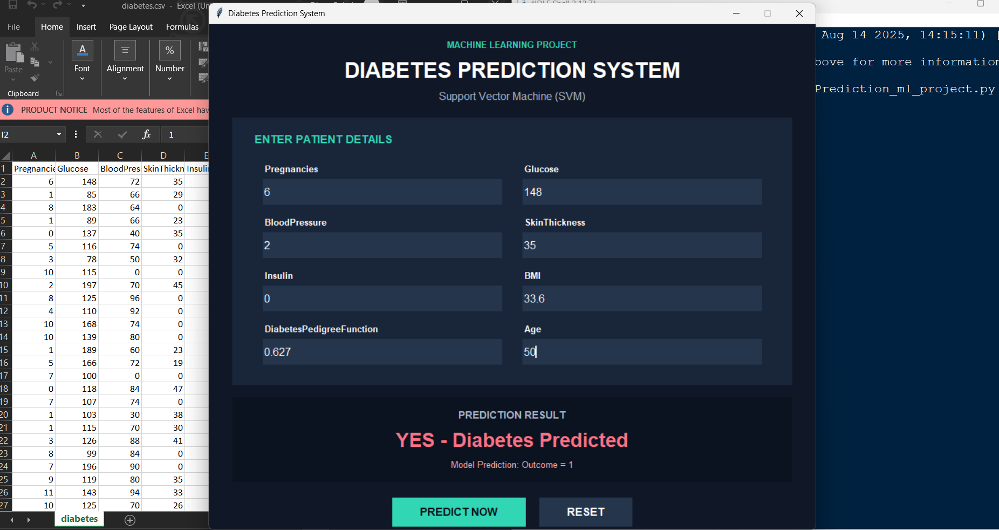
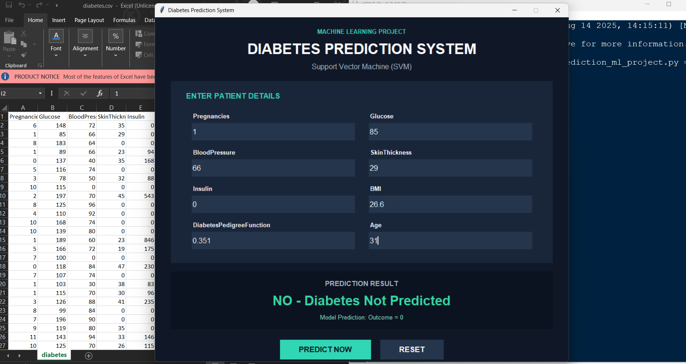

🩺 Diabetes Prediction System
A professional **Machine Learning Diabetes Prediction System** developed using Python and Support Vector Machine (SVM). This project predicts whether a person is likely to have diabetes based on medical input parameters using a trained machine learning model.

📸 Project Preview
 Diabetes Prediction System – GUI
 

 📌 Project Overview

The Diabetes Prediction System is a machine learning project developed using Python, Scikit-learn, and Tkinter.

The main objective of this project is to build a predictive system that analyzes patient-related input data and generates a diabetes prediction using a trained Support Vector Machine (SVM) classifier.

The system includes a graphical user interface (GUI) where users can enter patient details and obtain model predictions through an interactive application.

 🎯 Machine Learning Model

The project uses **Support Vector Machine (SVM)**, a supervised machine learning algorithm used for classification tasks.

The model is trained using the Diabetes dataset and learns patterns from input features to classify data into two categories:

- **Outcome 1:** Diabetes Predicted
- **Outcome 0:** Diabetes Not Predicted

 📊 Model Performance

The model performance is evaluated using training and testing accuracy.

- **Training Accuracy:** 78.66%
- **Testing Accuracy:** 77.27%

These values represent the model's performance on the training and testing datasets respectively.

 📈 Project Features

1. Diabetes Prediction**

Predicts the model's classification based on user-provided patient details.

2. Interactive GUI**

Provides a user-friendly interface developed using Tkinter.

3. Patient Input System**

Allows users to enter parameters such as Pregnancies, Glucose, Blood Pressure, BMI, Insulin, Age, and other required features.

4. Real-Time Prediction**

Displays the model's prediction after the user clicks the Predict Now button.

5. Prediction Result Display**

Shows whether the model predicts Outcome 0 or Outcome 1.

6. Reset Functionality**

Allows users to reset input fields and enter new patient details.

🛠️ Tools & Technologies

- **Python:** Used for project development and implementation.
- **Pandas:** Used for loading and handling dataset information.
- **NumPy:** Used for numerical operations.
- **Scikit-learn:** Used for model training and prediction.
- **Support Vector Machine (SVM):** Used as the classification algorithm.
- **StandardScaler:** Used for feature scaling.
- **Tkinter:** Used to develop the graphical user interface.
- **Matplotlib:** Used for visualization, if applicable.

💡 Project Highlights

- Implemented a supervised machine learning classification model.
- Used feature scaling to improve model processing.
- Evaluated model performance using training and testing accuracy.
- Developed an interactive GUI for user input and predictions.
- Integrated machine learning predictions into a desktop application.

🎯 Project Objective

The objective of this project is to demonstrate the practical implementation of machine learning in a healthcare-related prediction application by combining model training, data preprocessing, prediction, and GUI development.

**Note:** This project is for educational purposes only and is not intended to replace professional medical diagnosis.

👨‍💻 Author

**Dhruv Raheja**

Aspiring Data Analyst | Python | Machine Learning | Data Science | Data Analysis | Power BI

📧 Email: [dhruvvvraheja27@gmail.com](mailto\:dhruvvvraheja27@gmail.com)

⭐ If you find this project interesting, feel free to explore the project and its features.

**Thank you for visiting my project!**

